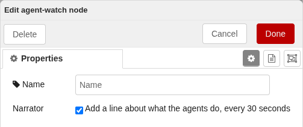

# @nrutils/node-red-agent-watch

[](https://www.npmjs.com/package/@nrutils/node-red-agent-watch)
[](https://github.com/UpDownMe733/nrutils-nodes/actions/workflows/ci.yml)
[](https://github.com/UpDownMe733/nrutils-nodes/blob/main/packages/agent-watch/LICENSE)

A [Node-RED](https://nodered.org) node that shows a short **running commentary** of the
[claude-agent](https://www.npmjs.com/package/@nrutils/node-red-claude-agent) nodes on its tab.

A flow with several agent stages is hard to follow: each stage has its own popup and its own
events. The agent-watch node collects them in one list, one short line at a time, with no wires.

- Free lines for each run: started, waits for an answer, answered, done, failed, stopped.
- A narrator adds one line about the work of each busy stage, every 30 seconds.
- The popup shows the total cost and the weighted tokens of all runs since the deploy.
- A message on the input adds the result of the flow as a green line.



## Contents

- [Requirements](#requirements)
- [Install](#install)
- [Node](#node)
- [Lines](#lines)
- [Narrator](#narrator)
- [Popup and status](#popup-and-status)
- [Messages](#messages)
- [Errors](#errors)
- [Limits](#limits)
- [Examples](#examples)
- [License](#license)

## Requirements

| | |
|---|---|
| Node-RED | ≥ 4.0 (tested on 5) |
| Node.js | ≥ 18 (Node-RED 5 needs ≥ 22) |
| Package | `@nrutils/node-red-claude-agent` 0.1 or later |
| OS / CPU | Each system that the claude-agent node runs on |

The node watches the claude-agent nodes and uses their [settings](https://github.com/UpDownMe733/nrutils-nodes/tree/main/packages/claude-agent#settings)
for the narrator. Read the [safety section](https://github.com/UpDownMe733/nrutils-nodes/tree/main/packages/claude-agent#safety-the-agent-gets-no-permission-prompt)
of the claude-agent node first.

## Install

In the Node-RED editor: **Menu → Manage palette → Install**, search
`@nrutils/node-red-agent-watch`.

Or on the command line, in your Node-RED user directory (usually `~/.node-red`):

```sh
npm install @nrutils/node-red-agent-watch
```

npm also installs `@nrutils/node-red-claude-agent` if it is not there. Then restart Node-RED. The
node is in the **agents** category of the palette.

## Node

| Property | Function |
|---|---|
| Name | The label of the node. |
| Narrator | Add a line about what the agents do, every 30 seconds. On by default. |

Put one agent-watch node on each tab that has claude-agent nodes. It sees only the nodes of its own
tab. It needs no wire to them.

## Lines

Each line has the time, the stage and a text. The stage is the name of the claude-agent node, else
its id. These lines come directly from the events of the runs and cost no tokens:

| Line | When |
|---|---|
| `Started.` | A run starts. |
| `WAITS: question to the operator: ...` | The agent asks a question. Yellow background. |
| `Operator answered.` | The answer has come. |
| `Done. N turns, N tokens.` | The run has ended with a result. |
| `FAILED: reason.` | The run has failed. Red background. The reasons are those of the claude-agent node. |
| `Stopped by the operator.` | Somebody stopped the run. |

## Narrator

With Narrator on, the node collects the text and tool events of the busy stages. Every 30 seconds,
if a stage did something new, it makes one call to the haiku model. The call gives at most one line
for each stage: what the agent does and for what purpose. One call uses about 1,500 tokens.

The call uses no tools, no MCP servers and no settings, so its request is small. It goes through
the launcher and the work root of the claude-agent settings. It runs with `bypassPermissions` too,
but with no tools.

If a narrator call fails, the node writes one warning to the Node-RED log and continues with the
free lines.

## Popup and status

Click the node to open the popup. It lists the lines, the newest at the bottom. The list scrolls
down by itself, unless you scroll up.

The status bar of the popup shows the total cost in dollars since the deploy, as the API reports it:
the ended runs (also the failed and stopped ones) and the narrator calls. After the cost it shows
the weighted tokens of the same runs and calls, for example `Total cost: $0.42, 118.2k weighted`.
The claude-agent README gives the formula of the weighted tokens.

The node status shows the stage and the newest line:

| Colour | Meaning |
|---|---|
| Blue | A stage runs. |
| Yellow | A stage waits for an answer. |
| Red | The newest line is an error. |
| Grey | No stage runs. |

## Messages

### Input

Wire the end of a flow to the input to show its result as one line with a green background.

| Property | Function |
|---|---|
| `topic` | The stage of the line. Default `Result`. |
| `payload` | The text of the line. An object shows as JSON. |

### Outputs

None.

## Errors

The node sends no error to a Catch node. A failed narrator call gives one warning in the log.

## Limits

- The node keeps the last 300 lines. A deploy clears them and the totals.
- A narrator line comes at most every 30 seconds. A stage that has ended gets no narrator line after
  its Done line.

## Examples

**Menu → Import → Examples → @nrutils/node-red-agent-watch**. The flow has two agent stages, draft
and shorten, and a watch node that shows their lines and the result. Each run uses the haiku model
with a cost limit of $0.20.

## License

Apache-2.0
