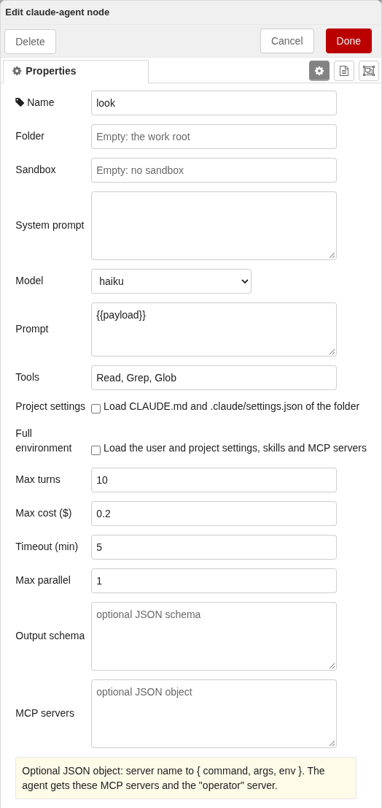

# @nrutils/node-red-claude-agent

[](https://www.npmjs.com/package/@nrutils/node-red-claude-agent)
[](https://github.com/UpDownMe733/nrutils-nodes/actions/workflows/ci.yml)
[](https://github.com/UpDownMe733/nrutils-nodes/blob/main/packages/claude-agent/LICENSE)

A [Node-RED](https://nodered.org) node that runs one **Claude Code agent** for each message.

Each message starts one agent run through the
[Claude Agent SDK](https://www.npmjs.com/package/@anthropic-ai/claude-agent-sdk). The node is one
stage of an agent workflow: a wire gives the result to the next stage. The agent can ask you a
question, and you answer in a popup on the node or with a message.

- The prompt is a mustache template over the message, for example `{{payload}}`.
- The result goes out with the session id, the turns, the tokens and the cost.
- A popup on the node shows the run as a chat and as a timeline. You can send a message, answer,
  interrupt or stop.
- Limits for each run: turns, cost, time, tools and the work folder.
- The node [agent-watch](https://www.npmjs.com/package/@nrutils/node-red-agent-watch) shows a short
  running commentary of all claude-agent nodes on a tab.



## Contents

- [Requirements](#requirements)
- [Install](#install)
- [Safety: the agent gets no permission prompt](#safety-the-agent-gets-no-permission-prompt)
- [Settings](#settings)
- [Node](#node)
- [Prompt and result](#prompt-and-result)
- [Questions and control messages](#questions-and-control-messages)
- [Popup](#popup)
- [Messages](#messages)
- [Errors](#errors)
- [Limits](#limits)
- [Examples](#examples)
- [License](#license)

## Requirements

| | |
|---|---|
| Node-RED | ≥ 4.0 (tested on 5) |
| Node.js | ≥ 18 (Node-RED 5 needs ≥ 22) |
| Claude | A Claude account or an Anthropic API key, logged in for the OS user that runs the CLI |
| OS / CPU | Linux, macOS or Windows: each system that the Claude Agent SDK supports |

npm installs the Claude Agent SDK with the node. The SDK brings its own Claude Code CLI. To log
in, run `claude` one time as the OS user that runs the CLI, or set `ANTHROPIC_API_KEY` in the
environment of Node-RED.

## Install

In the Node-RED editor: **Menu → Manage palette → Install**, search
`@nrutils/node-red-claude-agent`.

Or on the command line, in your Node-RED user directory (usually `~/.node-red`):

```sh
npm install @nrutils/node-red-claude-agent
```

Then restart Node-RED. The node is in the **agents** category of the palette.

## Safety: the agent gets no permission prompt

The node runs each agent with the permission mode `bypassPermissions`. A flow has nobody who can
answer a permission prompt, so the agent never asks: it runs each tool that it has, with the rights
of the OS user that runs the CLI. It can read, write and delete files, and run commands, also
outside its work folder.

Do these things before you give the node real work:

1. **Use a separate OS user or a container.** Run Node-RED in a container, or set a launcher
   program (see [Settings](#settings)) that starts the CLI as a user with few rights, for example
   with `sudo -u`. Do not run it as your own user or as root.
2. **Set a work root.** `claudeAgent.workRoot` limits the Folder of each run. It does not limit what
   the agent can reach, so use it together with step 1.
3. **Give only the tools that the task needs.** The Tools field is a list. `Read, Grep, Glob` can
   only read. An empty field gives all tools, also `Bash` and `Write`.
4. **Set the limits.** Max turns, Max cost and Timeout stop a run that does not end. Max parallel
   limits the runs at the same time.
5. **Keep secrets away.** The agent sees the environment of Node-RED, the files of its OS user and
   the text of each message. Do not give it keys that it does not need.

The prompt comes from the message. A message from outside (HTTP, MQTT, email) can tell the agent
to do something that you do not want. Check such text before it goes into the prompt.

## Settings

The node reads one block from the Node-RED `settings.js`. All entries are optional:

```js
claudeAgent: {
    launcher: '/opt/node-red/claude-launcher',     // the program that the SDK starts in place of the CLI
    workRoot: '/srv/agent-work',                   // each Folder must be this folder or below it
    sandboxPattern: '^box-[a-z0-9-]+$'             // the rule for a name in the Sandbox field
},
```

| Entry | Default | Function |
|---|---|---|
| `launcher` | the CLI of the SDK | The program that the SDK starts in place of the Claude Code CLI. It gets the arguments of the CLI and must start the CLI with them. Use it to run the CLI as a different OS user or in a container. |
| `workRoot` | the home folder of the Node-RED user | The Folder of each run must be this folder or a folder below it. |
| `sandboxPattern` | `^[A-Za-z0-9][A-Za-z0-9._-]*$` | A regular expression. A Sandbox name that does not match it fails the run. The editor also marks the field. |

A small launcher that runs the CLI as the OS user `worker`:

```sh
#!/bin/sh
exec sudo -n -E -H -u worker claude "$@"
```

The sudo rule for the Node-RED user needs the tag `SETENV`, so that the CLI gets the environment
of the run.

Restart Node-RED after a change to `settings.js`.

## Node

| Property | Function |
|---|---|
| Name | The label of the node. It is also the key of the result in `msg.stages`. |
| Folder | The work folder of the agent. Empty: the work root. `msg.cwd` replaces it. It must be the work root or below it. |
| Sandbox | A name for the launcher. See [Sandbox](#sandbox). Empty: no sandbox. |
| System prompt | Text that the node adds to the Claude Code system prompt. |
| Model | Empty (the SDK default), `haiku`, `sonnet` or `opus`. `msg.model` replaces it. |
| Cache time | `5 minutes` or `60 minutes`. How long the prompt cache lives between two requests of a run. Default 60 minutes. |
| Prompt | A mustache template over the message. Default `{{payload}}`. |
| Tools | A comma list of the tools of the agent. A new node has `Read, Grep, Glob`. Empty: all tools. |
| Project settings | Load `CLAUDE.md` and `.claude/settings.json` of the folder. Off by default. |
| Full environment | Load the user and project settings, the user `CLAUDE.md`, the skills and the MCP servers of the OS user that runs the CLI. Off by default. |
| Max turns | Default 30. |
| Max cost ($) | The cost limit of one run. Default 2. Empty: no limit. |
| Timeout (min) | The time limit of one run, also while it waits for an answer. Default 30. Empty: no limit. |
| Max parallel | The number of runs at the same time. Default 1. More start messages wait in a queue, in order. |
| Output schema | Optional JSON schema. Then the result is an object that agrees with the schema. |
| MCP servers | Optional JSON object: server name to `{ command, args, env }`. |

Without Project settings or Full environment, a run loads no settings, no `CLAUDE.md`, no skills
and no outside MCP servers. That keeps the first request of a run small. Auto memory is always off.
The node also turns off the Claude attribution lines in commit messages and pull requests.

The node gives Cache time to the CLI as the settings `promptCacheTtl` and `subagentPromptCacheTtl`.
It removes `FORCE_PROMPT_CACHING_5M` and `CLAUDE_CODE_PROMPT_CACHE_TTL` from the environment of the run,
so the node property decides. A 60-minute cache write costs 2× input, against 1.25× for 5 minutes.
A node from an older version gets 60 minutes. Before, the CLI chose: 1 hour on a subscription, 5 minutes with an API key.

The node has full help in the editor sidebar.

### Sandbox

A name in the Sandbox field goes to the launcher program in the environment of the CLI:

| Variable | Value |
|---|---|
| `NODE_RED_CLAUDE_SANDBOX` | the Sandbox name |
| `NODE_RED_CLAUDE_CWD` | the Folder of the run |

The launcher then starts the CLI in that container or on that machine, in that folder. The SDK
starts the launcher in the work root. The node checks the Folder only as a path, because the folder
is not on this machine. A Sandbox run needs `claudeAgent.launcher`.

## Prompt and result

The prompt is a mustache template over the message. An object value becomes JSON:

```
Check the change of {{payload.branch}}. The plan of the earlier stage: {{stages.plan}}
```

The result goes out on output 1, with all other properties of the start message:

- `msg.payload`: the final text of the agent, or the schema object.
- `msg.stages[<name>]`: the same value. The key is the node name, else the node id. The entries of
  earlier stages stay, so a later stage can use all of them.
- `msg.agent`: `{ runId, sessionId, model, turns, durationMs, tokens, weighted, usage }`.

To continue a session in a later message, put its `sessionId` into `msg.agent.resume`.

`weighted` is a price-weighted token count in "sonnet input tokens". For each model of the run:
`(input × 1 + cache write × 2 + cache read × r + output × 5) × weight`. The weight is 2 for a model
with `opus` in its name, 0.05 for `haiku` and 1 for all others. `r` is 0.1 for `haiku` and 0.05 for
all others. The node status shows it after the cost: `done, $0.12, 44.5k weighted`.

## Questions and control messages

Each run has the tool `ask_operator(question, options)`. When the agent calls it, the run waits.
The question goes out on output 2 and shows in the popup.

A control message has `msg.agent = { cmd, runId }` and a text in `msg.payload`. You can omit
`runId` when the node has one active run.

| `cmd` | Function |
|---|---|
| `answer` | The answer to the open question. |
| `message` | A new user message for the running session. |
| `interrupt` | Stop the current turn. The run stays open for a `message`. |
| `stop` | End the run. This is not an error: output 1 sends nothing. |

## Popup

Click the node to open the popup. It has two tabs:

- **Chat**: your text and the text of the agent, in full.
- **Timeline**: all events of the runs.

The status line shows the state, the turns and the tokens. When the agent asks a question, the
popup shows it with one button for each option. The message box has more than one line. Enter sends; Shift+Enter starts a new line. **Send** sends a message to the run, or the answer.
When no run is active, Send starts a run that continues the last session of the node.
**Interrupt** and **Stop** act on the selected run.

## Messages

### Input

| Property | Function |
|---|---|
| `payload` | The default prompt is `{{payload}}`. |
| `cwd` | Optional. The work folder of this run. |
| `model` | Optional. `haiku`, `sonnet` or `opus` for this run. The node ignores other values. |
| `agent.resume` | Optional. A session id: the run continues that session. |
| `agent.cmd` | Makes the message a control message. See above. |

### Outputs

1. **Result**: see [Prompt and result](#prompt-and-result).
2. **Question**: `msg.payload = { question, options }`, `msg.agent = { runId, sessionId, state: 'waiting' }`.
3. **Events**: `msg.topic = 'agent/<nodeId>/<runId>'`, `msg.payload = { runId, seq, time, kind, text }`.
   `kind` is one of `prompt`, `state`, `text`, `tool`, `tool_result`, `question`, `answer`,
   `message`, `turn`, `result` and `error`. The node cuts `text` after 300 characters.

## Errors

A failed run goes to a Catch node. `msg.agent.reason` tells why:

| Reason | Cause |
|---|---|
| `max_turns` | The run used Max turns. |
| `max_cost` | The run used Max cost. |
| `timeout` | The run took longer than Timeout. |
| `schema` | The agent gave no result that agrees with the Output schema. |
| `node_closed` | A deploy or a stop of Node-RED ended the run. |
| `sdk_error` | All other errors, for example a folder outside the work root, a Sandbox name against the rule, or no login. |

## Limits

- A deploy of the node ends its runs and clears the popup log.
- The popup keeps the last 200 events.
- A Sandbox name does nothing without a launcher that reads it.
- The work root limits only the start folder. The agent can reach all files that its OS user can
  reach. See [Safety](#safety-the-agent-gets-no-permission-prompt).

## Examples

**Menu → Import → Examples → @nrutils/node-red-claude-agent**. The flow asks an agent about its work
folder with read-only tools, lets an agent ask you a question in the popup, and sends a failed run
to a Catch node. Each run uses the haiku model with a cost limit of $0.20.

## License

Apache-2.0
