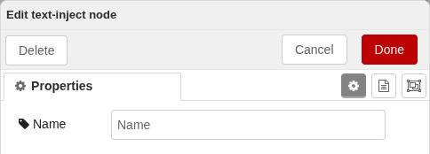

# @nrutils/node-red-text-inject

[](https://www.npmjs.com/package/@nrutils/node-red-text-inject)
[](https://github.com/UpDownMe733/nrutils-nodes/actions/workflows/ci.yml)
[](https://github.com/UpDownMe733/nrutils-nodes/blob/main/packages/text-inject/LICENSE)

A [Node-RED](https://nodered.org) node that sends the **text that you type** in its popup.

An inject node sends a fixed value. This node has a text box in a popup on the canvas. Type a text,
click Send, and it goes out as `msg.payload`. A new text needs no deploy.

- Type, paste or dictate a text of any length, with line breaks.
- **Ctrl+Enter** sends.
- The popup keeps the text, so you can change it and send again.



## Install

In the editor: **Menu → Manage palette → Install**, search `@nrutils/node-red-text-inject`. Or in
your Node-RED user directory:

```sh
npm install @nrutils/node-red-text-inject
```

Restart Node-RED. The node is in the **common** category. It needs Node-RED 4.0 or later and
Node.js 18 or later.

## Properties

| Property | Function |
|---|---|
| Name | The label of the node. |

The text is not stored in the flow.

## Send a text

1. Deploy the node one time.
2. Click the node to open the popup.
3. Type or dictate the text.
4. Click **Send** or press **Ctrl+Enter**.

**Clear** empties the text box.

## Output

| Property | Function |
|---|---|
| `payload` | The text of the popup, as a string. |

The node has no input.

## Status

The status of the node and the status line of the popup show the number of characters sent.

## Errors

The status line of the popup shows the problem:

- `No runtime node: deploy it, and check that it is not disabled`: the node is new or disabled.
- `No connection to Node-RED`: the editor has lost its connection.

## Limits

- The popup keeps the text until the editor page reloads.
- Each editor user has a separate text.
- A user needs write permission in the editor to send.

## Example

**Menu → Import → Examples → @nrutils/node-red-text-inject**.

## License

Apache-2.0
