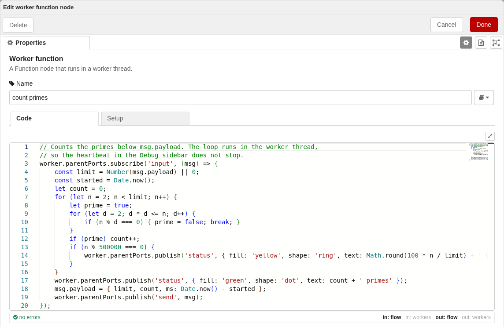
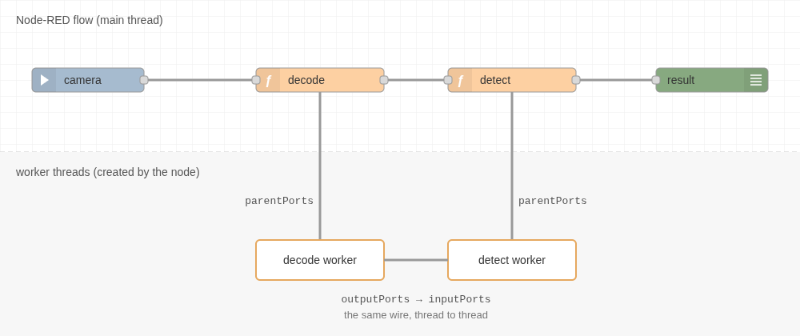

# @nrutils/node-red-worker-function

[](https://www.npmjs.com/package/@nrutils/node-red-worker-function)
[](https://github.com/UpDownMe733/nrutils-nodes/actions/workflows/ci.yml)
[](https://github.com/UpDownMe733/nrutils-nodes/blob/main/packages/worker-function/LICENSE)

A Function node for [Node-RED](https://nodered.org) that runs its code in a **worker thread**.

Heavy code in a core Function node blocks Node-RED: the editor freezes and other flows wait. This
node runs the code in its own thread, so Node-RED keeps running.

- The code is JavaScript, as in the Function node.
- Wired worker function nodes send messages thread to thread, not through Node-RED.
- Big buffers move to the thread with no copy.



## Install

In the editor: **Menu → Manage palette → Install**, search `@nrutils/node-red-worker-function`. Or
in your Node-RED user directory:

```sh
npm install @nrutils/node-red-worker-function
```

Restart Node-RED. The node is in the **function** category. It needs Node-RED 4.0 or later and
Node.js 18 or later. `node.linkcall()` needs Node-RED 5.

## Properties

| Property | Function |
|---|---|
| Name | The label of the node. |
| Code | The code that runs in the worker thread. A bar under the editor shows the errors and the paths. |
| Outputs | The number of outputs. Default 1. |
| Move the msg.payload buffer to the worker | Moves a large payload with no copy. Off by default. |
| Show the load in the node status | Shows `busy NN %` or `idle`, until the code sets its own status. Off by default. |
| Show a load meter on the node | Draws a load bar and a badge for the calls in progress. Off by default. |
| Modules | Modules to load into the code, as in the Function node. |

## Code

The worker is a separate thread. It cannot see the flow, the other nodes or the wires. It talks
through message pipes that the node creates:

- `worker.parentPorts`: to this node in Node-RED (flow messages, status, logs)
- `worker.inputPorts`: from each upstream worker function node
- `worker.outputPorts`: to each downstream worker function node

Use `subscribe(type, handler)` to listen and `publish(type, data)` to send.



The code runs once, when the node starts:

```js
worker.parentPorts.subscribe('input', async (msg) => {
    const factor = await flow.get('factor') || 2;
    msg.payload = msg.payload * factor;
    worker.parentPorts.publish('send', msg);
});
```

| Function node | worker function |
|---|---|
| `return msg;` | `worker.parentPorts.publish('send', msg);` |
| `node.send([a, b])` | `worker.parentPorts.publish('send', [a, b]);` |
| `node.status(s)` | `worker.parentPorts.publish('status', s);` |
| `node.warn(x)` | `worker.parentPorts.publish('warn', x);` (also `log`, `debug`, `trace`) |
| `node.error(x, msg)` | `worker.parentPorts.publish('error', { message: x, msg });` |
| `node.on('close', fn)` | `worker.parentPorts.subscribe('close', fn);` (2 s limit) |
| `node.linkcall(target, msg, { timeout })` | `await node.linkcall(target, msg, { timeout })`. Node-RED 5. Default timeout 5000 ms. |
| `flow.get('x')` | `await flow.get('x')` (all context calls return a Promise) |

## Ports and wires

Send through Node-RED, as `node.send()` does. Outputs count from 0:

```js
worker.parentPorts.publish('send', msg);              // output 1
worker.parentPorts.publish('send', [null, msg]);      // output 2 only
worker.parentPorts.publish('send', [[m1, m2], msg]);  // two messages on output 1, one on output 2
```

Send thread to thread. Node-RED and the Debug sidebar do not see these messages. A wire to a node
that is not a worker function gets only what `send` sends:

```js
worker.outputPorts.publish('input', msg);         // all outputs, all wires
worker.outputPorts[1].publish('input', msg);      // output 2, all its wires
worker.outputPorts[1][0].publish('input', msg);   // output 2, first wire only
```

Receive from upstream. `senderTrace` has `nodeId`, `portIndex` (output) and `connectionIndex`
(wire) of the sender:

```js
worker.inputPorts.subscribe('input', (msg, senderTrace) => {
    if (senderTrace.nodeId !== 'a1b2c3d4e5f60708') return;   // one sender only
    /* ... */
});
```

The type is any name that sender and receiver share. A handler for `default` gets all types.

## Big buffers

A `Buffer` arrives in the thread as a `Uint8Array`, also on the way out. Rebuild it with
`Buffer.from(u8.buffer, u8.byteOffset, u8.length)`. To move a result with no copy, add a transfer
list: `worker.parentPorts.publish('send', msg, [msg.payload.buffer])`. After a move, the sender
cannot use the buffer.

## Errors

- A throw in a handler is a node error with the line and column. A Catch node gets it. The worker
  keeps running.
- A syntax error stops the worker. The node shows `worker error` until a full deploy.

## Limits

- A `return` in a handler sends nothing. Use `publish('send', msg)`.
- `msg.req` and `msg.res` of an HTTP In node cannot go to a thread.
- A function in a message cannot be copied. A class instance arrives as a plain object.
- Each node has one thread. To use more cores, use several nodes.

## Example

**Menu → Import → Examples → @nrutils/node-red-worker-function**.

## License

Apache-2.0
