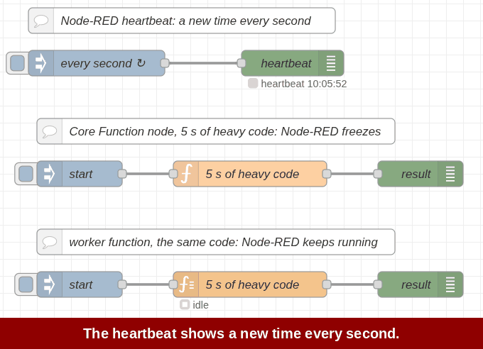

# @nrutils/node-red-worker-function

_A Function node for Node-RED that runs your code in a worker thread, so heavy work does not block Node-RED._



A Function node that parses, compresses or crunches numbers blocks Node-RED while it runs: the editor freezes, dashboards stall and other flows wait. The worker function node runs the same kind of code in its own thread, and Node-RED stays responsive.

For short code, keep using the core Function node. Each message is copied to the thread and back, which costs more than a short job saves.

## Features

- Write JavaScript as in the Function node, with `node`, `context`, `flow`, `global`, `env`, `RED.util` and the Modules list
- Optional load display: `busy NN %` or `idle` in the node status, and a load meter on the node
- Errors report the line and column, and reach Catch nodes
- Wire worker function nodes together and messages go thread to thread, not through Node-RED
- Move big buffers to the thread without a copy
- Call a Link In flow from the thread with `node.linkcall()` (Node-RED 5)

## Install

From **Manage palette** in the Node-RED editor, search for `@nrutils/node-red-worker-function`.

Or run this in your Node-RED user directory (usually `~/.node-red`), then restart Node-RED:

```
npm install @nrutils/node-red-worker-function
```

Requires Node-RED 4.0 or later and Node.js 18 or later.

## Usage

The code runs once, when the node starts. It subscribes to messages and publishes results:

```js
worker.parentPorts.subscribe('input', async (msg) => {
    const factor = await flow.get('factor') || 2;
    msg.payload = msg.payload * factor;
    worker.parentPorts.publish('send', msg);
});
```

Coming from the Function node:

| Function node | worker function |
| --- | --- |
| `return msg;` | `worker.parentPorts.publish('send', msg);` |
| `node.send([a, b])` | `worker.parentPorts.publish('send', [a, b]);` |
| `node.status(s)` | `worker.parentPorts.publish('status', s);` |
| `node.warn(x)` | `worker.parentPorts.publish('warn', x);` (also `log`, `debug`, `trace`) |
| `node.error(x, msg)` | `worker.parentPorts.publish('error', { message: x, msg });` |
| `node.on('close', fn)` | `worker.parentPorts.subscribe('close', fn);` |
| `flow.get('x')` | `await flow.get('x')` (all context calls return a Promise) |

The node's help in the editor has the full reference.

### Worker to worker

When a worker function node is wired to another, the two threads connect directly:

```js
// upstream node
worker.outputPorts.publish('input', msg);

// downstream node
worker.inputPorts.subscribe('input', (msg) => { /* ... */ });
```

These messages do not pass through Node-RED, so the Debug sidebar does not see them.

### Big buffers

Messages are copied into the thread. To move a large payload instead, tick **Move the msg.payload buffer to the worker (no copy)** on the Setup tab. To move a result back out, add a transfer list:

```js
worker.parentPorts.publish('send', msg, [msg.payload.buffer]);
```

## Things to know

- A `return` in a handler sends nothing. Use `publish('send', msg)`.
- A `Buffer` arrives as a `Uint8Array`, also on the way out. Use `Buffer.from(u8.buffer, u8.byteOffset, u8.length)` to get a Buffer back.
- A message from an HTTP In node cannot go to a thread, because `msg.req` and `msg.res` cannot be copied.
- Each node has one thread, and messages queue for it. To use more cores, spread the messages over several nodes.

## Example

**Import > Examples > @nrutils/node-red-worker-function** has a flow that counts primes in a thread while a heartbeat keeps running, and shows thread-to-thread messages, the load status and error handling.

## License

Apache-2.0
