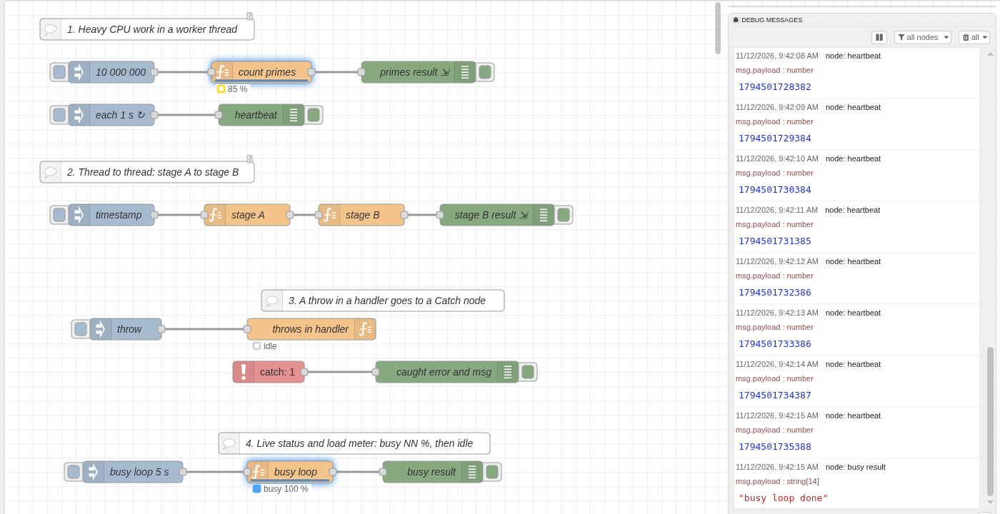
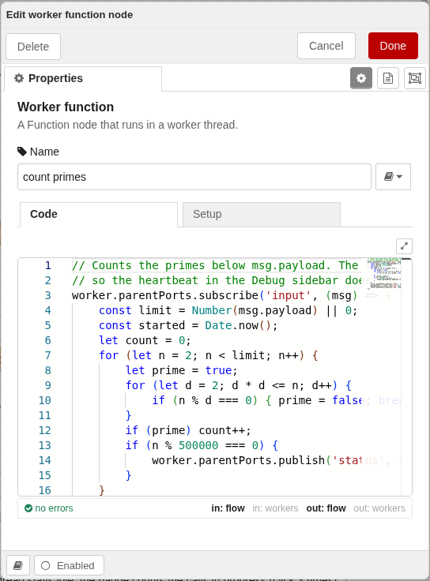

# @nrutils/node-red-worker-function

_A Node-RED Function node that runs its code in a worker thread, so heavy code does not block Node-RED._



Two worker function nodes keep their threads busy. Node-RED stays live: the heartbeat in the Debug sidebar still comes every second.

## Features

- Write code as in the Function node. The code runs in its own worker thread, so the editor, the dashboards and the other flows stay live.
- The names you know from the Function node: `msg`, `node`, `context`, `flow`, `global`, `env`, `RED.util`, `require` and the Modules list.
- Live load status on the node (`busy NN %` or `idle`), and an optional load meter.
- Errors show the line and the column, and go to a Catch node. The worker keeps running.
- Worker to worker: wire worker function nodes together, and the messages go from thread to thread, not through Node-RED.
- Big buffers can move to the thread with no copy.
- The code editor shows the errors in the code and the paths that the code uses.
- `node.linkcall()` calls a Link In flow from the thread (Node-RED 5).
- An example flow is included.

## When to use it

Use this node when a Function node makes Node-RED slow: the editor, the dashboard or other flows stop for a moment while the node runs. Typical jobs: parsing, compression, image or signal processing, big loops.

For short code, keep the core Function node. Each message is copied to the thread and back, so a short job gets slower.

## Install

Requirements: Node-RED 4.0 or later, Node.js 18 or later.

Use **Manage palette** in the editor and search for `@nrutils/node-red-worker-function`.

Or, in your Node-RED user directory (usually `~/.node-red`):

```
npm install @nrutils/node-red-worker-function
```

Then restart Node-RED.

## Quick start

1. Drag a **worker function** node from the palette into a flow, and wire it between an Inject node and a Debug node.
2. Open the node. The default code passes each message through. Replace the first `worker.parentPorts.subscribe('input', ...)` block of the default code with this:

   ```js
   worker.parentPorts.subscribe('input', async (msg) => {
       const factor = await flow.get('factor') || 2;
       msg.payload = msg.payload * factor;
       worker.parentPorts.publish('send', msg);
   });
   ```
3. Deploy, and click the Inject node.



For a full demo, use **Import > Examples > @nrutils/node-red-worker-function > worker-function**. The flow counts primes in a worker thread while a heartbeat in the Debug sidebar keeps on. It also sends a message from one worker thread to another, shows a busy loop, and shows a throw that a Catch node gets.

## Move a Function node

**The code runs one time, when the node starts. It does not run for each message. Put your old code inside the input handler.**

A Function node:

```js
const factor = flow.get('factor') || 2;
msg.payload = msg.payload * factor;
node.status({text: 'done'});
return msg;
```

The same code in worker function:

```js
worker.parentPorts.subscribe('input', async (msg) => {
    const factor = await flow.get('factor') || 2;
    msg.payload = msg.payload * factor;
    worker.parentPorts.publish('status', {text: 'done'});
    worker.parentPorts.publish('send', msg);
});
```

A variable at the top level, outside the handler, keeps its value from message to message. It keeps the value until the node restarts (a deploy of the node).

- Write `async` before a handler only when you use `await` in it.
- Put `await` before each context call: `flow.get`, `global.get`, `context.get`, `env.get` and the set calls.
- A handler with `await` lets the next message start, so the outputs can come in a different order. To keep the order, do not use `await` in the handler.

## Common mistakes

- **`return msg;` in a handler.** The node sends nothing and gives no error. Use `worker.parentPorts.publish('send', msg);`.
- **`flow.get()` without `await`.** You get a Promise, so maths gives `NaN`. Put `await` before the call.
- **`subscribe` after an `await`.** The handler misses the first messages. Call `subscribe` at the top level, before any `await`.
- **`msg` outside a handler.** The code outside a handler has no `msg`. Use `msg` only inside a handler.
- **A message from an HTTP In node fails.** See [What cannot go to the thread](#what-cannot-go-to-the-thread).
- **A Buffer comes out as a Uint8Array.** See [What cannot go to the thread](#what-cannot-go-to-the-thread).

## What cannot go to the thread

- A function, or an object that contains a function, cannot be copied. The publish throws a `DataCloneError`.
- A message with `msg.req` and `msg.res` (from an HTTP In node) cannot go to a thread. To use this node after an HTTP In node, remove both first with a Change node. The HTTP Response node then cannot answer from that msg.
- A `Buffer` arrives as a `Uint8Array`, in both directions: into the thread, and out of it to the next node.

When a node downstream needs a Buffer, make one before you send. This makes no copy:

```js
msg.payload = Buffer.from(msg.payload.buffer, msg.payload.byteOffset, msg.payload.length);
worker.parentPorts.publish('send', msg);
```

## From the Function node

| Function node | worker function |
| --- | --- |
| the `msg` of the flow | `worker.parentPorts.subscribe('input', (msg) => { ... });` |
| `return msg;` | `worker.parentPorts.publish('send', msg);` A `return` in a handler does nothing. |
| `node.send([a, b])` | `worker.parentPorts.publish('send', [a, b]);` |
| `node.warn(x)` | `worker.parentPorts.publish('warn', x);` |
| `node.log(x)` | `worker.parentPorts.publish('log', x);` Also `debug` and `trace`. |
| `node.error(x, msg)` | `worker.parentPorts.publish('error', { message: x, msg });` |
| `node.status(s)` | `worker.parentPorts.publish('status', s);` |
| `node.on('close', fn)` | `worker.parentPorts.subscribe('close', fn);` You have 2 seconds. |
| `flow.get('x')` | `await flow.get('x')`. All context calls return a Promise. |

## Pipelines: worker to worker

Skip this section if you use one node.

A wire from one worker function node to another links the two threads. The message goes from thread to thread and does not go through Node-RED. The main thread of the downstream node gets no input message, and the Debug sidebar does not see it.

`publish('send')` (to the flow) and `outputPorts.publish` (to the threads) are separate paths on the same wire. Use the one you need.

`worker.outputPorts.publish(type, msg)` sends to the threads of the wired worker nodes. `worker.inputPorts.subscribe(type, handler)` gets them. The type is free text and must be the same on both ends. The handler gets `(msg, senderTrace, receiverTrace, type)`; the traces hold the node id and the port and wire numbers of the sender and the receiver.

Example with three nodes, A, B and C, wired A to B to C:

```js
// A
worker.parentPorts.subscribe('input', (msg) => {
    worker.outputPorts.publish('input', msg);
});

// B
worker.inputPorts.subscribe('input', (msg) => {
    worker.outputPorts.publish('input', msg);
});

// C
worker.inputPorts.subscribe('input', (msg) => {
    worker.parentPorts.publish('send', msg);
});
```

To send to one output or one wire:

- `worker.outputPorts.publish(...)` sends on all wires of all outputs.
- `worker.outputPorts[p]` is output `p` (0 is the first output).
- `worker.outputPorts[p][w]` is wire `w` on that output, in the order of the wires of the node. These numbers are stable.
- A publish to a port with no connected worker is dropped without an error, as in Node-RED when an output has no wire.

Limits:

- A wire into a subflow input does not link threads. The upstream worker is wired to the subflow instance node, which is not a worker. Inside a subflow, workers that are wired to each other are linked.

## Names in scope

| Name | What it is |
| --- | --- |
| `worker` | `parentPorts` (this node and the flow), `inputPorts` and `outputPorts` (other worker nodes, see Pipelines) |
| `node` | `{ id, name, path, outputCount }` of the node, and `linkcall()`. `path` is the path of the node through its subflows. |
| `context`, `flow`, `global` | the stores of this node, of the tab, and of all flows. Each has `get(key, [store])`, `set(key, value, [store])` and `keys([store])`, and each returns a Promise. `context.flow` and `context.global` are the same objects as `flow` and `global`. |
| `env` | `get(name)` returns a Promise for the environment variable. |
| `require` | loads a Node.js built-in, or a module in the Node-RED user directory. With `functionExternalModules: false` it loads Node.js built-ins only. |
| `util` | the Node.js `util` module |
| `RED` | `RED.util` with the helpers that work in a thread: `cloneMessage`, `compareObjects`, `encodeObject`, `ensureBuffer`, `ensureString`, `generateId`, `getMessageProperty`, `setMessageProperty`, `getObjectProperty`, `setObjectProperty`, `normalisePropertyExpression`, `normaliseNodeTypeName`, `parseContextStore`. The helpers that need the runtime (for example `evaluateNodeProperty`) are not there. |
| Node.js globals | The globals of a worker thread are also in scope, for example `setTimeout`, `setInterval`, `Buffer` and `console`. `console.log` writes to the output of the Node-RED process, not to the Debug sidebar. Use `publish('warn')` for the Debug sidebar. |

### node.linkcall

`node.linkcall(target, msg, [options])` sends `msg` to a Link In node, as a Link Call node does. `target` is the name or the id of the Link In node. The Promise resolves with the message of the Link Out node in return mode. It rejects when the target is not found, after `options.timeout` milliseconds (default 5000), or when the node closes. On Node-RED 4 it rejects with `node.linkcall needs Node-RED 5 or later`.

### Modules

The modules in the **Modules** list (Setup tab) are in scope under their variable names. Node-RED installs them in the user directory, as for the Function node. The setting `functionExternalModules: false` turns the list off. An ES module with no CommonJS build needs Node.js 22.12 or later.

Example: in the Modules list, set the module to `jimp` and the variable to `Jimp`. Then use it in the code:

```js
const img = await Jimp.read(Buffer.from(msg.payload.buffer, msg.payload.byteOffset, msg.payload.length));
```

A native module loads in a worker thread only when it is context-aware. Check the docs of the module.

## Big data

A transfer list moves an `ArrayBuffer` with no copy. The sender cannot use it after that:

```js
worker.parentPorts.publish('send', msg, [msg.payload.buffer]);
```

Move only a buffer that covers its whole `ArrayBuffer`. This check must be true:

```js
payload.byteOffset === 0 && payload.byteLength === payload.buffer.byteLength
```

A transfer to more than one wire does not work. The first wire gets the buffer, and the publish to the second wire fails with a `DataCloneError`. For more wires, leave out the transfer list.

The option **Move the msg.payload buffer to the worker (no copy)** (Setup tab) does this for the input. It moves an `ArrayBuffer`, or a typed array, `Buffer` or `DataView` that covers its whole `ArrayBuffer`. A payload that cannot move goes as a copy with no warning. Use the check above to test your payload.

After a move, the buffer is empty everywhere it is still used on the Node-RED side, for example in a context store.

Do not keep big data in context. Each context call copies the value between the threads. Pass it in the message.

## Load and queue

Each node has one worker thread. Messages wait in a queue with no limit. Ten messages that each need 1 s of CPU take 10 s.

To use more cores, put more nodes in the flow, for example behind a Switch node that splits the messages.

Two signs show when the thread cannot keep up:

- **Status:** until the code publishes a `status`, the node shows the load of the worker thread: `busy NN %` (to the nearest 10) or `idle`.
- **Load meter:** the option **Show a load meter on the node** (off by default) draws a thin bar on the node. A badge shows the calls in progress, and the node tooltip shows the numbers.

## Close

When the node closes, it publishes `close` to the thread. It waits up to 2 seconds for the close handlers (an async handler is awaited). Then it stops the thread.

A thread in a long synchronous loop cannot run its close handler until the loop ends. The deploy waits the full 2 seconds, and the cleanup does not run.

To let a long job stop, split it with `await new Promise(setImmediate)` between the parts. Check a flag that the close handler sets:

```js
let closing = false;
worker.parentPorts.subscribe('close', () => { closing = true; });
worker.parentPorts.subscribe('input', async (msg) => {
    for (const part of msg.parts) {
        if (closing) return;
        work(part);
        await new Promise(setImmediate);
    }
});
```

## Errors

- A throw or a rejected Promise in a handler (`parentPorts` or `inputPorts`) is a node error with `(line L, col C)`. A Catch node gets the incoming msg as the handler left it. The worker keeps running.
- A throw outside a handler is a node error with no msg.
- `publish('error', { message, msg })`: a Catch node gets your msg.
- A syntax error, or a crash of the thread, stops the worker. The node shows `worker error`. A Full deploy or Restart Flows starts it again. The default "Modified Nodes" deploy does not restart a node that you did not change.
- `send` takes a message object or null, an array of these (one for each output), or an array of arrays (several messages on one output). Other data gives a node error that names the wrong type.

## Source and issues

This package is part of the [nrutils-nodes](https://github.com/UpDownMe733/nrutils-nodes) repo. It is built on [@nrutils/node-red-utils](https://www.npmjs.com/package/@nrutils/node-red-utils).

## License

Apache-2.0
